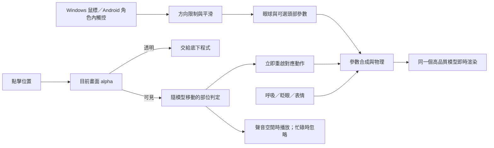

# Anzuki：互動桌寵與 VTuber 模型技術調查

調查日期：2026-10-23。範圍：官方 Live2D Web／Java 範例與 Framework、VTube Studio 公開 API、開源桌寵與替代 2D 模型技術。資料來源與固定版本見文末及 [source-index.json](source-index.json)。

本文件區分來源中可確認的功能與 Anzuki 的設計建議。沒有實際操作 VTube Studio／Cubism Editor，也沒有實測 Anzuki 骨骼模型；目前沒有可用的 Anzuki 模型包。一般官方網站不在本環境允許的連線範圍，本次以官方 GitHub 文件／原始碼為主要證據；價格、委託行情與官方網站上的完整最新商業條款未核實。

## 建議與原因

目前需求以 **Live2D Cubism 的參數化網格模型**最合適：小幅眼球追視、眨眼、呼吸、頭部反應、髮絲及衣物物理，比全身大型動作更重要。它不是把一段影片變成骨架，而是把分層畫稿綁定成可即時變形的模型。Spine 是另一種可行的骨骼／網格方案，但本次不必先為大幅走跳建立整套角色動作。

先做獨立實驗，不替換已可用的 WebP 版本。模型品質合格後，再將 Windows 與 Android 的模型模式一起交付。

程式端可實作輸入、追視、部位判定、動作管理與檔案驗證；精緻立繪的分層補畫、Cubism 網格／變形器綁定與參數極限仍需在製作工具中實際調整並做美術驗收。目前本分支未產生這些模型資產，也不承諾單張 PNG 的自動拆圖能達到正式品質。

## 網路上類似作品怎麼做

| 專案／工具 | 查到的實作方式 | 對 Anzuki 的意義 |
| --- | --- | --- |
| Live2D 官方 Cubism Web Samples | 載入 `.model3.json`／`.moc3`／貼圖；視線資料驅動眼球和頭部參數；點 Head 切表情，點 Body 播動作。[S1–S5] | 兩個初步目標已有成熟基礎，但仍要自行完成桌面座標、精確命中、部位分派與連點政策。 |
| VTube Studio | 追蹤輸入經映射變成 Live2D 參數；外掛可經 WebSocket 注入參數、啟用表情、執行熱鍵。[S6] | 適合檢查建模品質及參數，不必把整個 VTube Studio 當成 Anzuki 必裝依賴。 |
| OpenSeeFace／VSeeFace 路線 | OpenSeeFace 是攝影機人臉追蹤，不是模型播放器；README 說明 VSeeFace 用它驅動 VRM／VSFAvatar，VTube Studio 也用它追蹤 Live2D。[S7] | VTuber 的「即時」來自連續參數更新。Anzuki 的輸入是鼠標，第一階段不需要攝影機、人臉辨識或 3D 模型。 |
| EasyLive2D/live2d-py | Python 包裝 Native SDK，直接以 OpenGL 顯示模型，列有視線追蹤、點擊互動和精確到部件的點擊檢測。[S8] | 證明原生桌面互動可行；現有 Anzuki 已是 Electron，不必為此改寫成 Python。 |
| pixi-live2d-display | 提供 `focus`、`tap` 與 hit-area 名稱事件；預設互動亦可關閉後自行餵座標。[S11] | 方便理解互動介面。但該版 README 指定 Pixi 6、Cubism 2.1／4，不能直接假定支援所有 Cubism 5.3 新功能。[S12] |
| VPet | WPF 桌寵，以狀態、互動與 PNGAnimation 組織動畫，另可用外掛加入 l2d／spine。[S9] | 桌寵互動可獨立於渲染器；「會摸頭」本身不代表採骨骼動畫。 |
| dsh-pet | 原始影片經透明素材管線，搭配動畫切換、點擊、拖曳和物理。[S10] | 是目前原版影片／WebP 路線的參考，不能直接從這類素材得到獨立眼球或可變形的臉。 |
| Petto | 由桌寵控制程式透過 Kage／Live2DViewerEX 宿主管理模型、動作與表情。[S19] | 顯示「行為控制」與「模型顯示」可以分開；其外部宿主方案不等於可直接同步到現有 Android App。 |

### 為什麼不直接用 VTube Studio 熱鍵驅動整個桌寵

公開 API 的 `InjectParameterDataRequest` 注入的是追蹤輸入，仍需模型內的參數映射；不是任意 PSD 都能動。`HotkeyTriggerRequest` 文件明載同一熱鍵每 5 幀才能觸發一次，不同熱鍵可能排隊，隊列最多 32 個。[S6，約 L675–701、L1288–1290、L1368–1430]

這與使用者已指定的「連點立即重播、不阻隔、不排隊」不同。Anzuki 應在自己的播放器處理動作重新起播與過渡；VTube Studio 可當檢查工具，而不是正式產品的動作排程器。

## 目標一：待機時眼睛追隨鼠標

官方樣例將追蹤 X/Y 對應到 `ParamEyeBallX`／`ParamEyeBallY`，並可連動 `ParamAngleX/Y/Z`、`ParamBodyAngleX`。[S2，約 L423–453] 模型必須真的綁定這些參數；只有同名參數而沒有網格變形，眼睛仍不會動。

Anzuki 第一版只先開眼球追視，輕微轉頭作可選項，避免整個身體一直扭動。建議流程：

1. Windows 主程序取得桌面鼠標座標；現有程式已每約 16 ms 取得一次，即使寵物失焦或鼠標在角色外也可使用。
2. 將桌面 DIP 座標轉為視窗座標，處理視窗大小、多螢幕縮放、留白與模型變換，得到相對於眼睛中心的方向。
3. 方向正規化並限制在模型的可用範圍；左右眼使用一致目標，避免鬥雞眼。超出螢幕或離開有效追蹤範圍時緩慢回正。
4. 使用以秒計算的平滑，例如 `w = 1 - exp(-dt / tau)`，`value += (target - value) * w`。這是建議實作，`tau` 必須實看後調整，不能把動作表情全部拖慢。
5. 每幀重新合成參數，不累加上幀殘值；待機眨眼、呼吸和髮絲物理繼續運作。反應動作若需要閉眼／轉頭，依其權重暫時降低追視，結束後恢復。

追視不等於攔截點擊：眼睛可以看著遠處鼠標，透明背景仍必須讓滑鼠穿過。第一版不增加攝影機或麥克風需求。

### Android 的差異

觸控螢幕沒有常駐鼠標。手指觸碰角色時可看向手指，放開後回正；可選擇在安靜待機時偶爾小幅看向不同方向。外接鼠標／觸控筆的懸停，只能在 App 實際收到的事件範圍處理。一般懸浮窗無法一邊讓其他 App 正常操作，一邊取得整個手機畫面的所有觸控位置，不應承諾與 Windows 全桌面追視完全相同。

## 目標二：依點擊部位播放不同回應

建模師應提供隨模型變形的命中區域，程式以語意名稱對應動作；不採固定螢幕矩形或單純依畫面高度切成幾段。左右一律以角色自身方向命名。

| 區域建議 | 回應初稿 | 素材需求 |
| --- | --- | --- |
| 頭／帽子 | 輕低頭、柔和眨眼，髮絲小幅跟隨 | 頭部動作、眼瞼變形、髮絲物理 |
| 左／右臉頰 | 對應側輕偏頭、驚訝後微笑 | 左右分開的區域與動作；不要求先做大幅臉頰拉扯 |
| 左／右手與袖套 | 小幅抬起相應手，袖口回彈 | 手臂與袖套分層、相應的手部姿勢 |
| 披肩 | 肩膀輕縮、披肩晃動 | 披肩分層與物理 |
| 鞋子 | 腳尖小移動或短促重心變化 | 鞋、腳踝、裙擺遮擋補畫；可延到第二階段 |
| 其他可見部分 | 一般點擊回應 | 通用動作 |

這些是待確認的設計，不是宣稱現有影片包含了上述動作。最小驗證先做頭、臉、手三組，通過後再加披肩與鞋。

### 兩層命中判定，保留透明點穿

官方 Framework `CubismUserModel.isHit()` 讀取指定 Drawable 的變形後頂點，再求軸對齊外框 AABB；不是逐像素 alpha，也不是三角形內部測試。[S4，約 L286–329] 所以不能直接用官方樣例宣稱已符合 Anzuki 的透明點穿要求。

Anzuki 需要兩層：

1. **視覺命中**：目前真正渲染出的 alpha 是否大於零，包含剪裁、透明度與留白；透明時讓系統點穿。
2. **部位命中**：把座標反變換到模型座標，測試隨動的互動網格／多邊形，依顯示遮擋與區域優先權選出一個部位。沒有部位但有可見像素時用通用回應。

臉頰與頭、手與披肩可能重疊，因此不能只採陣列中的第一個大矩形。模型作者可提供專用 HitArea ArtMesh，亦可用已識別的可見 Drawable 作對應；程式仍需補上精確的三角形／遮擋處理。專用命中區域須參與相同變形，不代表要在畫面畫出彩色區域。

現有 WebP 是 Canvas 2D；Live2D WebGL 的 alpha 要另做讀回／命中遮罩設計，不可假設原 `hit-test.js` 無修改即可使用。逐幀整張 GPU `readPixels` 可能造成停頓，需比較只取鼠標附近與獨立命中緩衝的方法。命中用的資料不改動顯示貼圖。Android 懸浮窗的可觸控區域同樣需要重新整合；官方 Activity 範例不等於已解決懸浮窗透明點穿。Android 13+／舊版差異仍需保留並實機驗證。

### 連點、動作混合與聲音

- 點擊動作每次立即重新開始，不等目前動作播完；新區域的動作取代舊回應，無動作排隊或冷卻。預先載入短動作，避免首次點擊還要讀檔。
- SDK 的一般優先權預約會拒絕相同或更低優先權；官方樣例另有 force 路徑。因此必須明確實作重啟，而不是沿用預設 reserve 規則。[S2，約 L635–648]
- 「立即起播」與「硬切模型姿勢」不同：舊回應取消後，新的時間軸從 0 開始，以短過渡權重接到新姿勢，避免連點抽搐。過渡時間以模型實看調校。
- 一個合成步驟統一處理：動作、表情、眨眼、追視、呼吸、物理、最終模型更新；哪些參數由動作暫時接管必須明確。不要讓待機時間軸每幀把眼球追視寫回正中。
- 聲音沿用獨立單通道：載入或播放中忽略新請求，播完後下一次點擊才接受；不打斷、不排隊。點擊動畫的 1.0–2.0 倍不改變聲音速度。嘴形如後續加入，以目前正在播的錄音為準。

## Windows 與 Android 的整合選擇

| 平台 | 優先評估 | 要另外完成的事情 |
| --- | --- | --- |
| Windows | 現有 Electron 透明視窗 + 官方 Cubism SDK for Web | 模型檔載入、GPU 渲染、全桌面追視、alpha 點穿、分部位動作、顯示縮放與托盤／設定銜接。 |
| Android | 現有 Java App + 官方 Cubism SDK for Java | GLES 透明繪圖與懸浮窗、生命週期／GL context 重建、觸控區域、手機追視模式、待機耗電。官方範例用 GLSurfaceView 與 GLES 2.0。[S13–S14] |
| Android 替代 | WebView + 共用 Web 模型程式 | 有共用程式的優點，但透明 WebGL 合成、懸浮視窗觸控及機型差異要實機比較後才可選定；目前不預設一定較快或較省電。 |

相同模型資源可供不同 SDK 使用，仍須確認輸出的 `.moc3` 功能與兩邊 Core 相容；本次官方 develop 文件皆列 Cubism 5.3。正式實作要固定 SDK／Core 版本，不追著 develop 自動更新。[S1、S13] 兩邊共用 byte-identical 模型包與互動映射，不能各自手改兩套素材。

## 其他方案是否值得用

| 方案 | 優點 | 本次取捨 |
| --- | --- | --- |
| Live2D Cubism | 插畫式臉部變形、表情與髮衣物理；VTuber 生態成熟；官方 Web／Java 路線可配合現有兩平台。 | 優先。需要拆圖、補畫及專業綁定，並確認 Core 與發行授權。 |
| Spine | 骨骼、網格、動畫混合、隨骨骼更新的 bounding-box 多邊形。[S16] | 若下一階段以走路、跑跳等全身動作為主可再比較；不代表做不出追視。Editor 輸出與 Runtime 版本要配對。[S15] |
| Inochi2D | 同樣以分層圖、參數與網格變形；有開源 SDK、C FFI、WASM 建置途徑。[S17] | 可行的開源替代，但 Electron／Android 整合、工具鏈、可委託建模資源需額外驗證，目前證據不足以認為會比 Cubism 少工。 |
| 3D／VRM | 適合多角度、全身空間動作；VSeeFace 路線使用 3D 模型。[S7] | 需要另做 3D 模型、材質與綁定，會重新處理立繪觀感，超出這次眼球與點擊互動的必要範圍。 |
| 保留逐幀 WebP | 原美術、原動作直接保留，已可用。 | 持續保留為原版；不能從整張影像中獨立控制眼睛。 |

### 授權與檔案交付

Live2D Framework／Samples、專有 Core、官方範例模型各有不同條款；GitHub 能看到程式不等於所有內容都可按 MIT 任意重發。Core 不包含於官方 Web／Java 範例倉庫，需由官方 SDK 取得。[S1、S13、S18] 本分支目前沒有加入 Core 或第三方角色模型。正式選版時核對 Core 再散布、發行用途與實際營收類別；不在本文件承諾免費商用或固定費用。

Spine Runtime README 則明確區分評估、軟體使用者自行持有授權，以及整合者持有 Editor 授權後向無 Editor 授權的一般使用者發行等情境。[S15] 委託建模還要包含可修改工程、桌寵 Windows／Android 發行及模型檔公開 GitHub 的權利。

## 素材與藝術品質

目前倉庫 v2–v5 PNG 參考圖原生尺寸皆為 **1024×1536**，且是合成單張；現有動畫為原尺寸 **720×1280** 無損 RGBA WebP。它們能提供造型／動作參考，但沒有眼球後方、頭髮遮住的臉、袖套遮住的手臂等完整圖層，不能直接視為可用模型。

完整需求見 [ART-BRIEF.zh-TW.md](../../materials/live2d-v1/ART-BRIEF.zh-TW.md)。優先要的是定稿分層 PSD（或等價的原尺寸透明圖層）與可維護的 Cubism 工程，再交完整匯出模型包。只做嘴巴／眼睛局部貼圖會限制轉頭和身體動作；只把 PNG 放大不會增加細節。

不要為了小下載而縮圖、有損壓縮、降貼圖品質或對原片轉碼。分層母稿始終保留原尺寸。貼圖集排版可能重新採樣／改變邊緣，必須以原生細節和實際近看驗收，不把「PNG 無損」當成「模型完全沒有品質損失」的證明。貼圖過大時先分多張並查手機 GPU 上限，不靜默縮小；只計單張 RGBA 4096² 即約 64 MiB 顯存，8192² 約 256 MiB，尚未計其他緩衝與貼圖。

## 建議實作順序與驗收

1. **素材檢查**：造型定稿、分層與遮擋補畫、眼球／眼皮及手臂可動範圍。通過才綁定；不先用粗糙自動拆圖冒充成品。
2. **最小模型**：眼球 XY、眨眼、呼吸、輕微頭部 XY；頭／臉／手三組點擊回應；髮絲及披肩小幅物理。先提交檢查影片與模型包。
3. **Windows 實驗播放器**：沿用透明視窗、拖曳、設定、音聲；完成全桌面追視、精確命中與連點，與原版可分開啟動／回退。
4. **Android 同步**：使用同一模型包，實作觸控模式與透明懸浮；必須實機測功耗、GL context 恢復與點穿。
5. **美術驗收後擴充**：左右細分、更多手勢／鞋部反應，及可選錄音嘴形。

需要觀察的具體結果：

- 鼠標在角色外、螢幕四角、不同 DPI 螢幕時，左右眼方向一致、眼球不穿出眼框、沒有抖動或瞬間翻轉。
- 眨眼與閉眼表情不露瞳孔，嘴／眉／臉頰不錯層；髮絲、袖套、披肩不穿模，星飾不扭曲。
- 角色在轉頭／抬手時仍能點到正確部位，頭部不吞掉臉頰，前景遮擋後面的手時不誤觸。
- 背景、髮絲間縫隙與視窗留白能操作底下程式；不能只測角色外框。
- 連點不同部位時每次重啟，舊動作結束回呼不覆蓋新動作；錄音仍只播目前一段，播完不補播排隊內容。
- GPU 每幀更新以 60 Hz 顯示為初步目標，採時間步進；不是對舊影片補幀。手機負載與耗電需實測，若調整渲染更新頻率要明示，不能犧牲貼圖品質。
- 模型、貼圖、動作匯入前後 SHA-256 一致；原版 WebP、MP4、個人錄音與設定不改寫。實驗成功後 Windows 仍提供必要更新 ZIP，Android 提供同簽章更新 APK。

## 來源

以下均為本次讀取的 GitHub 文件／程式，固定版本及用途亦存於 [source-index.json](source-index.json)。

- [S1：Live2D/CubismWebSamples — 官方 Web SDK、Core 分開下載與版本相容資訊](https://github.com/Live2D/CubismWebSamples/blob/b1de66b0b1f1cb881d95fb6158622aeb6a2827bd/README.md)
- [S2：Live2D/CubismWebSamples — 視線參數與動作強制優先權](https://github.com/Live2D/CubismWebSamples/blob/b1de66b0b1f1cb881d95fb6158622aeb6a2827bd/Samples/TypeScript/Demo/src/lappmodel.ts)
- [S3：Live2D/CubismWebSamples — 頭部／身體點擊分派](https://github.com/Live2D/CubismWebSamples/blob/b1de66b0b1f1cb881d95fb6158622aeb6a2827bd/Samples/TypeScript/Demo/src/lapplive2dmanager.ts)
- [S4：Live2D/CubismWebFramework — isHit 使用變形後頂點的 AABB](https://github.com/Live2D/CubismWebFramework/blob/d4da0aa07e47d2c1e4f5fa7ea6047861ea5e5d0b/src/model/cubismusermodel.ts)
- [S5：Live2D/CubismWebSamples — 模型、貼圖、動作、表情、物理及 HitAreas 檔案結構](https://github.com/Live2D/CubismWebSamples/blob/b1de66b0b1f1cb881d95fb6158622aeb6a2827bd/Samples/Resources/Haru/Haru.model3.json)
- [S6：DenchiSoft/VTubeStudio — 追蹤參數注入、熱鍵、認證與熱鍵冷卻／排隊](https://github.com/DenchiSoft/VTubeStudio/blob/6dd6f9072686be374f44af0041e499df7b63337f/README.md)
- [S7：emilianavt/OpenSeeFace — 攝影機追蹤與渲染軟體分工](https://github.com/emilianavt/OpenSeeFace/blob/50c09741897010faad721a218b2bbe14ecad6251/README.md)
- [S8：EasyLive2D/live2d-py — 原生桌面模型顯示、視線與部位點擊能力](https://github.com/EasyLive2D/live2d-py/blob/1f1e7adda0dfebd08981a29bb549da34bdf60d8c/README.md)
- [S9：LorisYounger/VPet — 桌寵狀態／互動與 PNG 動畫架構](https://github.com/LorisYounger/VPet/blob/37989091954f020f294b6a2137632186b2bc22c6/README_zht.md)
- [S10：PC2005-cloud/dsh-pet — 原參考的影片素材管線與桌面互動](https://github.com/PC2005-cloud/dsh-pet/blob/48007b64ac0bebb2e97ac88344aed62de8399dd4/README.md)
- [S11：guansss/pixi-live2d-display — focus 與 tap 分工](https://github.com/guansss/pixi-live2d-display/blob/31317b37d5e22955a44d5b11f37f421e94a11269/docs/docs/interactions.md)
- [S12：guansss/pixi-live2d-display — Pixi 6 與 Cubism 2.1／4 相容需求](https://github.com/guansss/pixi-live2d-display/blob/31317b37d5e22955a44d5b11f37f421e94a11269/README.md)
- [S13：Live2D/CubismJavaSamples — 官方 Android Java 整合途徑](https://github.com/Live2D/CubismJavaSamples/blob/8ce6803de7030a4816bccd8a3efcad69ea1d1186/README.md)
- [S14：Live2D/CubismJavaSamples — GLSurfaceView／GLES 2.0 與觸控處理](https://github.com/Live2D/CubismJavaSamples/blob/8ce6803de7030a4816bccd8a3efcad69ea1d1186/Sample/src/full/java/com/live2d/demo/full/MainActivity.java)
- [S15：EsotericSoftware/spine-runtimes — Spine Runtime 授權與 Editor 版本配對](https://github.com/EsotericSoftware/spine-runtimes/blob/9f7d44b725df0766b3995093cea8e7342faf9367/README.md)
- [S16：EsotericSoftware/spine-runtimes — 跟隨骨骼更新的互動多邊形](https://github.com/EsotericSoftware/spine-runtimes/blob/9f7d44b725df0766b3995093cea8e7342faf9367/spine-ts/spine-core/src/SkeletonBounds.ts)
- [S17：inochi2d/inochi2d — Inochi2D 參數網格、C FFI 與 WASM 路徑](https://github.com/inochi2d/inochi2d/blob/4975d247f9b946a74d18e0ba9b3e9475eb636efb/README.md)
- [S18：Live2D/CubismWebSamples — Framework／Core／範例模型的不同授權](https://github.com/Live2D/CubismWebSamples/blob/b1de66b0b1f1cb881d95fb6158622aeb6a2827bd/LICENSE.md)
- [S19：funnycups/petto — 桌寵控制與外部模型宿主的分工](https://github.com/funnycups/petto/blob/476138cd235c9957088de7814ffad695a5d0469c/README.md)

[S1]: https://github.com/Live2D/CubismWebSamples/blob/b1de66b0b1f1cb881d95fb6158622aeb6a2827bd/README.md
[S2]: https://github.com/Live2D/CubismWebSamples/blob/b1de66b0b1f1cb881d95fb6158622aeb6a2827bd/Samples/TypeScript/Demo/src/lappmodel.ts
[S3]: https://github.com/Live2D/CubismWebSamples/blob/b1de66b0b1f1cb881d95fb6158622aeb6a2827bd/Samples/TypeScript/Demo/src/lapplive2dmanager.ts
[S4]: https://github.com/Live2D/CubismWebFramework/blob/d4da0aa07e47d2c1e4f5fa7ea6047861ea5e5d0b/src/model/cubismusermodel.ts
[S5]: https://github.com/Live2D/CubismWebSamples/blob/b1de66b0b1f1cb881d95fb6158622aeb6a2827bd/Samples/Resources/Haru/Haru.model3.json
[S6]: https://github.com/DenchiSoft/VTubeStudio/blob/6dd6f9072686be374f44af0041e499df7b63337f/README.md
[S7]: https://github.com/emilianavt/OpenSeeFace/blob/50c09741897010faad721a218b2bbe14ecad6251/README.md
[S8]: https://github.com/EasyLive2D/live2d-py/blob/1f1e7adda0dfebd08981a29bb549da34bdf60d8c/README.md
[S9]: https://github.com/LorisYounger/VPet/blob/37989091954f020f294b6a2137632186b2bc22c6/README_zht.md
[S10]: https://github.com/PC2005-cloud/dsh-pet/blob/48007b64ac0bebb2e97ac88344aed62de8399dd4/README.md
[S11]: https://github.com/guansss/pixi-live2d-display/blob/31317b37d5e22955a44d5b11f37f421e94a11269/docs/docs/interactions.md
[S12]: https://github.com/guansss/pixi-live2d-display/blob/31317b37d5e22955a44d5b11f37f421e94a11269/README.md
[S13]: https://github.com/Live2D/CubismJavaSamples/blob/8ce6803de7030a4816bccd8a3efcad69ea1d1186/README.md
[S14]: https://github.com/Live2D/CubismJavaSamples/blob/8ce6803de7030a4816bccd8a3efcad69ea1d1186/Sample/src/full/java/com/live2d/demo/full/MainActivity.java
[S15]: https://github.com/EsotericSoftware/spine-runtimes/blob/9f7d44b725df0766b3995093cea8e7342faf9367/README.md
[S16]: https://github.com/EsotericSoftware/spine-runtimes/blob/9f7d44b725df0766b3995093cea8e7342faf9367/spine-ts/spine-core/src/SkeletonBounds.ts
[S17]: https://github.com/inochi2d/inochi2d/blob/4975d247f9b946a74d18e0ba9b3e9475eb636efb/README.md
[S18]: https://github.com/Live2D/CubismWebSamples/blob/b1de66b0b1f1cb881d95fb6158622aeb6a2827bd/LICENSE.md
[S19]: https://github.com/funnycups/petto/blob/476138cd235c9957088de7814ffad695a5d0469c/README.md
