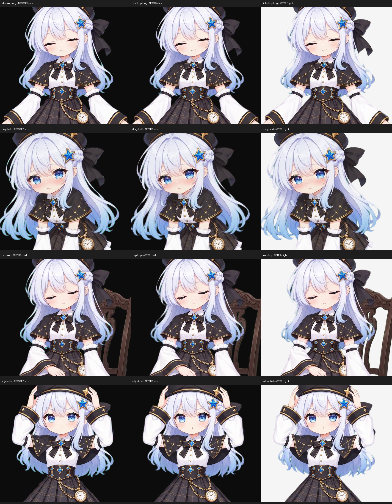

# 髮絲綠邊修復與新版抓起

以原始 MP4 重新去背，保留 720×1280、24 fps。新版「抓起」使用本次提供的 [grab_loop.mp4](original/grab_loop.mp4)，共 109 格，原檔未改寫；仍沿用固定 2 倍播放速度。「扶帽子」維持原片第 48～239 格，即移除前 2 秒。

11 組動畫都採用 closed-form alpha matting 估算細髮與半透明邊緣，再還原前景顏色。綠幕顏色只用背景像素估算；不模糊角色、不重畫頭髮、不侵蝕輸出的髮絲遮罩。對綠幕邊緣 10 px 內的綠／青綠溢色作局部校正，髮絲的紅、藍通道細節及未受污染的內部顏色保留。修正色邊可能改動原本不透明的污染像素，因此另行記錄 `opaquePixelsChanged`，不宣稱所有邊緣 RGB 未變。

輸出為無損 RGBA animated WebP，無縮圖、無有損重新壓縮、不改幀率、不加入或補繪畫格，不含影片音軌。每格編碼後均比對處理前 RGBA 雜湊（alpha=0 下的不可見 RGB 正規化為 0）；受保護的內部像素變更數與可見綠色優勢像素數必須為 0。完整結果見 [manifest.json](manifest.json)，每支動畫的個別報告見 `verification/`；透明 PNG 樣張在 `previews/`。

Windows 與 Android 複製完全相同的 WebP。先前來源與母版保留在 animation-v1、v2-lossless、v3、v4-trim，方便回查。這次所有動畫均修正，Windows 必要更新包會包含各支有變更的動畫，並保留原有程式執行檔、個人設定及錄音。

重製：安裝 `numpy scipy pillow pymatting==1.1.16` 與 FFmpeg，執行 `python scripts/repair-green-edges.py --workers 3`，再執行 `python scripts/sync-android-assets.py`。處理在原解析度完成；重跑會重用已有雜湊核對成功的逐片結果。
